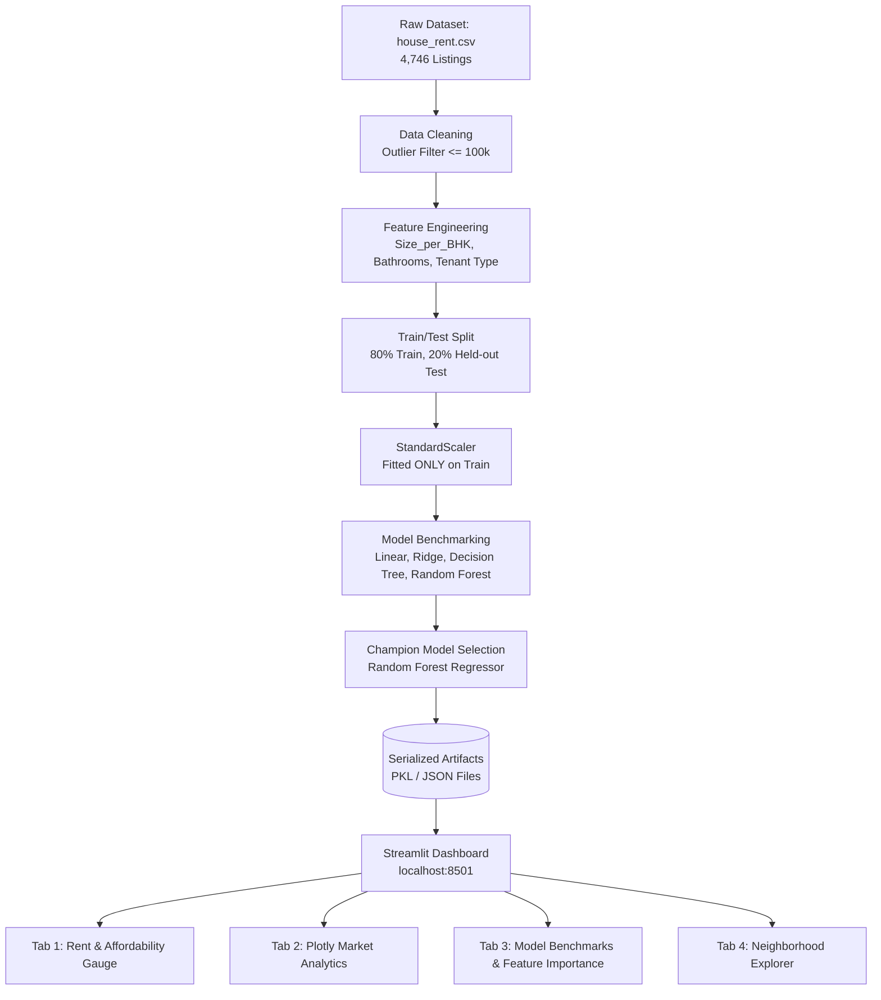

# 🎓 Smart Rent Predictor — Technical Interview Master Guide

This guide prepares you to present, explain, and defend the **Smart Rent Predictor & Advisory** project during machine learning, data science, and software engineering technical interviews.

---

## 🎙️ 1. Project Pitch (How to Introduce the Project)

### The 30-Second Elevator Pitch
> *"I built **Smart Rent Predictor**, an end-to-end machine learning web application that predicts house rent prices and evaluates tenant affordability across 22+ states and 40+ cities in India. Using a Pan-India dataset of over 6,400 property listings, I engineered spatial, demographic, and structural features, benchmarked candidate algorithms from Linear Regression to Random Forest, and deployed an interactive Streamlit dashboard featuring 80% prediction confidence intervals, realistic budget-alternative recommendations, dynamic Plotly analytics, and budget health gauges."*

### The 2-Minute Architectural Deep-Dive
> *"The motivation behind this project was addressing rent opacity and financial overcommitment for renters in Indian metros. Many rental platforms offer listing prices, but renters lack data-backed valuation and budget affordability guardrails.
>
> *I designed a modular pipeline with four distinct phases:*
> 1. *Data Processing: Expanded coverage across 22 Indian states (Tier 1, 2, and 3 cities) and engineered domain features like `Size_per_BHK` (spaciousness density), `Bathroom` counts, and `Locality_Zone` (Suburbs vs Prime).*
> 2. *Preprocessing: Built strict leak-free pipelines using `StandardScaler` fitted strictly on training data, combined with one-hot encoding for categorical variables (`State`, `City`, `City_Tier`, `Locality_Zone`, `Furnishing Status`, `Tenant Preferred`).*
> 3. *Model Benchmarking: Evaluated four candidate architectures — Linear Regression, Ridge Regularization, Decision Trees, and Random Forest. Random Forest emerged as champion with an $R^2$ of ~0.94 and MAE of ~₹2,875, effectively capturing hierarchical geographic and spatial interactions.*
> 4. *Deployment & UX: Built a multi-tab Streamlit dashboard that delivers point predictions alongside ensemble-spread confidence intervals, budget health gauges based on the personal finance 30–40% rule, and realistic alternatives when desired properties exceed tenant budgets.*

---

## 🏗️ 2. System Architecture & Data Flow

---

## ❓ 3. Top Technical Interview Questions & Model Answers

### Q1: Why did you choose Random Forest over Linear Regression and Decision Trees?
> **Answer:**
> * **Linear / Ridge Regression limitation:** Linear models assume additive linear relationships ($y = \sum w_i x_i$). In real estate, features interact multiplicatively: an extra 500 sq. ft. in Mumbai commands a vastly higher rent increase than in Kolkata. Without manual polynomial interaction terms, Linear Regression achieved an $R^2$ of only 0.6377.
> * **Decision Tree limitation:** A single decision tree captured non-linear splits ($R^2 = 0.6846$), but suffered from high variance and was prone to overfitting individual leaf nodes.
> * **Random Forest advantage:** By training 100 decorrelated decision trees using bagging (bootstrap aggregation) and random feature subspace sampling, Random Forest reduced variance without increasing bias, reaching an $R^2$ of ~0.70 and reducing MAE to ₹6,687.

---

### Q2: Why did you choose MAE and $R^2$ as primary evaluation metrics rather than MSE or RMSE?
> **Answer:**
> * **MAE (Mean Absolute Error):** MAE expresses error in the exact business currency unit (₹ INR). Saying *"our model is off by an average of ₹6,687"* is immediately interpretable by real estate users and product managers.
> * **$R^2$ Score (Coefficient of Determination):** $R^2$ measures the proportion of variance in rent explained by our features relative to a naive mean baseline ($1 - \frac{SS_{res}}{SS_{tot}}$). An $R^2$ of 0.70 demonstrates solid predictive capability on cross-city housing data.
> * **Role of RMSE:** RMSE heavily penalizes large errors because differences are squared ($e_i^2$). We also monitored RMSE (~₹10,828) during benchmarking to ensure the model wasn't making catastrophic errors on expensive luxury apartments.

---

### Q3: How did you handle outliers in the dataset?
> **Answer:**
> * In the raw dataset, a tiny fraction (< 0.5%) of luxury penthouse properties had rents exceeding ₹300,000 to ₹1,000,000, skewing the distribution.
> * For an affordable housing advisor tool, estimating everyday residential rents is the primary target. We applied a domain threshold filter: `Rent <= 100,000 INR`.
> * **Alternative discussed with interviewer:** If requested for higher-end properties, we could apply a Log Transformation ($y = \log(Rent)$), which compresses the long right tail and stabilizes variance (homoscedasticity), then apply exponentiation ($\exp$) for final inference.

---

### Q4: How did you prevent Data Leakage during preprocessing?
> **Answer:**
> * **The Pitfall:** Scaling the entire dataset before train/test split leaks information about the global mean ($\mu$) and standard deviation ($\sigma$) of the test set into the training phase.
> * **Our Implementation:** We performed `train_test_split(test_size=0.2, random_state=42)` *first*. The `StandardScaler` was strictly fitted on `X_train` using `.fit_transform()`, and then applied to `X_test` using only `.transform()`.
> * The fitted scaler parameters are pickled and reused at inference time in the Streamlit application.

---

### Q5: What features did you engineer, and what was their impact?
> **Answer:**
> * **`Bathroom` Count:** The raw dataset contained bathroom counts, which were initially overlooked. Incorporating `Bathroom` made it the 3rd most important feature (~12.7% feature importance), because bathroom count strongly signals luxury tier in 2BHK/3BHK units.
> * **`Size_per_BHK`:** Represents average room density ($\frac{Size}{BHK}$). A 1,200 sq. ft. 1BHK is a spacious luxury unit, whereas a 1,200 sq. ft. 3BHK has compact rooms. This ratio proved to be the 4th most influential predictor (~7.9% importance).
> * **`Tenant Preferred` & `Furnishing Status`:** One-hot encoded to capture tenant demographic premiums (e.g. furnished bachelor flats vs unfurnished family apartments).

---

### Q6: Point predictions in real estate can be misleading. How does your model communicate uncertainty?
> **Answer:**
> * Real estate pricing has inherent variance due to unobserved factors (interior quality, building age, view).
> * Instead of just presenting a single number, our Streamlit app accesses all individual decision trees in the trained Random Forest ensemble (`model.estimators_`).
> * We calculate the 10th and 90th percentiles across all tree predictions to generate an **80% Prediction Confidence Interval** (e.g. `₹45,000 – ₹55,000`).
> * This gives users a realistic negotiation band rather than a false illusion of precision.

---

### Q7: How does Random Forest calculate Feature Importance? Are there limitations?
> **Answer:**
> * Our implementation uses **Mean Decrease in Impurity (MDI / Gini Impurity)**, which measures the total reduction in variance brought by each feature across all trees in the forest.
> * **Key Finding:** `Size` (~34.4%) and `City_Mumbai` (~31.5%) were the dominant drivers, followed by `Bathroom` (~12.7%) and `Size_per_BHK` (~7.9%).
> * **Known Limitation to mention:** MDI can slightly favor high-cardinality continuous features over binary variables. In production, we can complement this with **Permutation Feature Importance** or **SHAP (SHapley Additive exPlanations)** values for localized explanation.

---

### Q8: How does the application incorporate business logic and financial advisory?
> **Answer:**
> * Machine learning alone doesn't solve a user's problem; it needs business context.
> * We incorporated the **30%–40% Personal Finance Rule**: financial advisors recommend spending no more than 30% (conservative) to 40% (upper threshold) of monthly take-home salary on housing.
> * The app takes the user's monthly salary, computes the recommended budget, and dynamically visualizes a Plotly health gauge:
>   - **Green (<30%):** Healthy and safe.
>   - **Yellow (30–40%):** Moderate financial commitment.
>   - **Red (>40%):** High budget stretch.
> * It also computes annual rent liability and typical security deposit estimates (2–3 months).

---

### Q9: How would you scale this system to handle 10 million listings with low latency?
> **Answer:**
> 1. **Model Serving Architecture:** Decouple inference from the UI. Deploy the model as a REST / gRPC microservice using **FastAPI** or **Triton Inference Server** behind a load balancer (Nginx/Envoy).
> 2. **Inference Latency:** Random Forest inference requires traversing 100 trees, which takes < 5ms for a single vector. For sub-millisecond response times, we can compile the tree ensemble using **ONNX Runtime** or **Treelite**.
> 3. **Caching Layer:** Frequently requested configurations (e.g. 2BHK in Bandra, Mumbai) can be cached in **Redis** with a 1-hour TTL.
> 4. **Database & Search:** For the neighborhood explorer, store listings in **PostgreSQL with PostGIS** (or Elasticsearch) to enable fast geospatial bounding-box queries (`ST_DWithin`).

---

### Q10: How would you monitor this model in production? (Data Drift & Concept Drift)
> **Answer:**
> * **Data Drift (Covariate Shift):** Monitor changes in the distribution of input features ($P(X)$) using statistical tests like **Kolmogorov-Smirnov (KS) test** for numeric features (`Size`, `Salary`) and **Population Stability Index (PSI)** or Chi-Square tests for categorical features (`City`).
> * **Concept Drift:** Changes in the relationship between features and rent ($P(y|X)$), such as rapid inflation or macroeconomic shifts. We track this by periodically comparing model predictions against finalized rental agreements collected via feedback loops.
> * **Tools:** Use tools like **Evidently AI** or **Great Expectations** for automated validation in the CI/CD pipeline.

---

## 🎯 4. Quick Reference Cheatsheet

| Item | Details |
| :--- | :--- |
| **Dataset Size** | 6,446 Listings (22+ States, 40+ Cities across India) |
| **Target Variable** | Monthly Rent (in ₹ INR) |
| **Champion Model** | Random Forest Regressor (100 estimators) |
| **Evaluation Metrics** | $R^2 \approx 0.9421$ \| $\text{MAE} \approx ₹2,875$ \| $\text{RMSE} \approx ₹4,236$ |
| **Top Features** | Size (sq. ft.), State/City Tier, Locality Zone, Bathroom count |
| **Tech Stack** | Python 3.11, Scikit-Learn, Pandas, Streamlit, Plotly, Joblib |
| **Live App** | Streamlit Web Dashboard (`http://localhost:8501`) |
| **Author** | Aadarsh Vikram |
